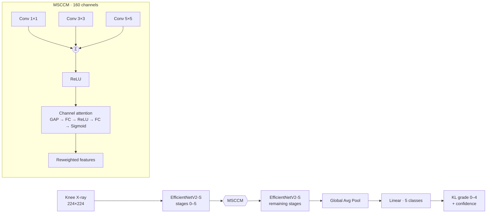
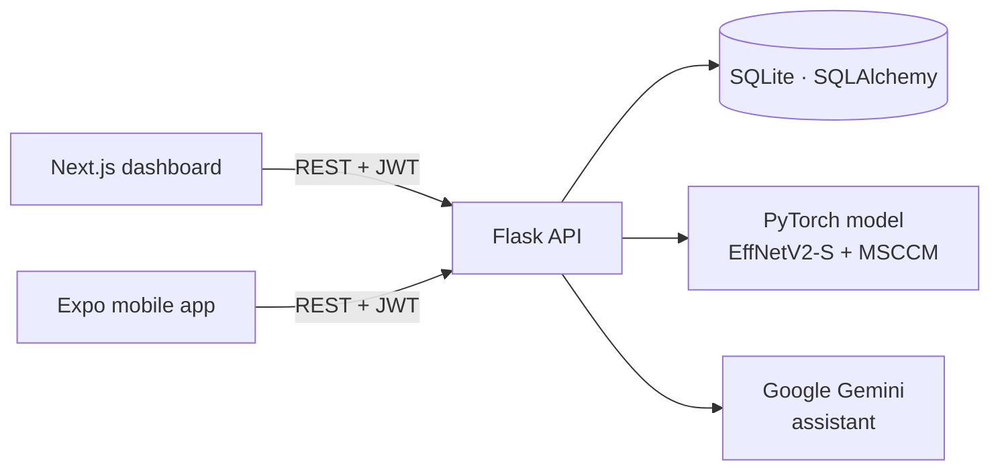

<div align="center">

# 🦴 Knee Osteoarthritis Severity Grading

**EfficientNetV2-S + Multi-Scale Convolution & Channel-attention Module (MSCCM)**

Automated Kellgren–Lawrence (KL) grading of knee X-rays, packaged as a full clinical-style application:
a Flask inference API, a Next.js dashboard, a React Native mobile app and a Gemini-based assistant.

[](#)
[](#)
[](#)
[](#)
[](#)
[](LICENSE)

📄 *Presented at **IconDeepCom 2026***

</div>

---

## Contents

- [Overview](#overview)
- [Results](#results)
- [Model architecture](#model-architecture)
- [Training setup](#training-setup)
- [Application](#application)
- [Getting started](#getting-started)
- [API reference](#api-reference)
- [Project structure](#project-structure)
- [Publication](#publication)
- [Disclaimer](#disclaimer)

## Overview

Knee osteoarthritis is graded on the five-level **Kellgren–Lawrence scale** (0 Healthy → 4 Severe). Grading by eye is slow and varies between readers, and neighbouring grades — especially *Doubtful* (1) and *Minimal* (2) — look almost identical on a radiograph.

This project tackles that with a pretrained **EfficientNetV2-S** backbone extended by a lightweight **MSCCM** block that captures features at several receptive-field sizes and reweights channels by importance. The trained model is served through a role-based web and mobile application used by **administrators**, **doctors** and **patients**.

## Results

| Model | Test accuracy (5 KL grades) |
|---|:---:|
| EfficientNetV2-S + MSCCM — published version ([notebook](training/effnetv2s_msccm.ipynb)) | **79.35 %** |
| Refined version after publication | **80.15 %** |

**What did not help.** Several additions that looked promising were evaluated and removed because they *lowered* accuracy: a gated fusion unit, a two-stage attention module, MixUp augmentation and differential learning rates.

## Model architecture



- **Backbone** — EfficientNetV2-S pretrained on ImageNet (torchvision).
- **MSCCM** — inserted once after the first 160-channel stage. Parallel 1×1, 3×3 and 5×5 convolutions are summed, then a squeeze-and-excitation style block (reduction 16) reweights the channels.
- **Head** — global average pooling → linear layer with 5 outputs.

## Training setup

| Setting | Value |
|---|---|
| Dataset | Knee Osteoarthritis Dataset with class balance (Kaggle) — 8,000 train / 2,000 test |
| Pre-processing | grayscale → 3 channels, resize 224×224, ImageNet normalisation |
| Augmentation | random horizontal flip, random rotation ±7° |
| Loss | cross-entropy, label smoothing 0.05 |
| Optimiser | AdamW · lr 3e-4 · weight decay 1e-4 |
| Scheduler | ReduceLROnPlateau on validation accuracy (factor 0.5, patience 2) |
| Epochs / batch size | 25 / 16 |
| Hardware | NVIDIA Tesla T4 (Kaggle) |

The full training script is in [`training/train.py`](training/train.py).

## Application



| Role | What they can do |
|---|---|
| **Admin** | Manage users, view all patients and scans, read activity logs, see system statistics |
| **Doctor** | Manage patients, upload X-rays, review predictions, annotate scans, export PDF reports |
| **Patient** | Upload scans, view their own results and history, ask the assistant about their grade |

Highlights: JWT authentication with role-based route protection · scan upload with instant inference and confidence score · PDF report export · light/dark themes · Gemini assistant that explains results (with an offline keyword fallback).

## Getting started

### Prerequisites

- Python 3.10+, Node.js 18+, npm
- Trained weights `best_effnetv2s_msccm.pth` placed in the repository root
  *(not committed because of size; without them the API starts with random weights for demo purposes)*

### 1 · Backend

```bash
cd backend
python -m venv .venv && source .venv/bin/activate   # Windows: .venv\Scripts\activate
pip install -r requirements.txt
cp .env.example .env                                 # then set JWT_SECRET (and optionally GEMINI_API_KEY)
python app.py                                        # → http://localhost:5000
```

On first start the database is created and three demo accounts are seeded:

| Role | Username | Password |
|---|---|---|
| Admin | `admin` | `admin123` |
| Doctor | `doctor1` | `doctor123` |
| Patient | `patient1` | `patient123` |

### 2 · Web dashboard

```bash
cd frontend
npm install
npm run dev        # → http://localhost:3000
```

### 3 · Mobile app

```bash
cd mobile
npm install
npx expo start     # scan the QR code with Expo Go
```

## API reference

| Method | Endpoint | Description |
|---|---|---|
| `POST` | `/api/auth/login` | Log in and receive a JWT |
| `GET` | `/api/auth/me` | Current user |
| `POST` | `/predict` | Run inference on an uploaded X-ray |
| `POST` | `/api/scans/upload` | Upload a scan for a patient and store the prediction |
| `GET` | `/api/scans` | List scans (filtered by role) |
| `GET` | `/api/scans/export` | Export scans |
| `GET · PUT · DELETE` | `/api/scans/<id>` | Read, annotate or remove a scan |
| `GET · POST` | `/api/patients` | List or create patients |
| `GET · POST` | `/api/admin/users` | Manage users (admin only) |
| `GET` | `/api/admin/stats` · `/api/admin/logs` | Statistics and activity logs (admin only) |
| `POST` | `/api/chat` | Ask the Gemini assistant |
| `GET` | `/api/health` | Health check |

## Project structure

```
OA_Detection/
├── backend/            Flask API — auth, role-based routes, inference, SQLAlchemy models, Gemini chat
│   ├── app.py
│   ├── auth.py
│   ├── database.py
│   ├── inference.py
│   ├── model_loader.py
│   └── routes_*.py
├── frontend/           Next.js + TypeScript + Tailwind dashboard (admin / doctor / patient views)
├── mobile/             Expo React Native app
├── training/
│   ├── effnetv2s_msccm.ipynb   Kaggle notebook with outputs (published model)
│   └── train.py                Training and evaluation script
└── LICENSE
```

## Publication

A. S. D. S. Rao, T. C. Raj, Dr. T. Illakiya — *Automated Osteoarthritis Detection and Severity Grading from Knee X-rays Using Deep Learning*, IconDeepCom 2026.

## Tech stack

**ML** PyTorch · torchvision · scikit-learn  **Backend** Flask · SQLAlchemy · PyJWT · Google Gemini
**Web** Next.js · React · TypeScript · Tailwind CSS · Framer Motion · jsPDF  **Mobile** React Native · Expo · React Navigation

## Disclaimer

This is a research prototype, **not a medical device**. Predictions must not be used for diagnosis without review by a qualified clinician.

## License

Copyright © 2026 Chatush Raj Thotamsetty. **All rights reserved.**

This code is published for viewing and evaluation only. It may not be copied, reused, modified or redistributed, in whole or in part, without written permission. See [LICENSE](LICENSE) for the full terms.
